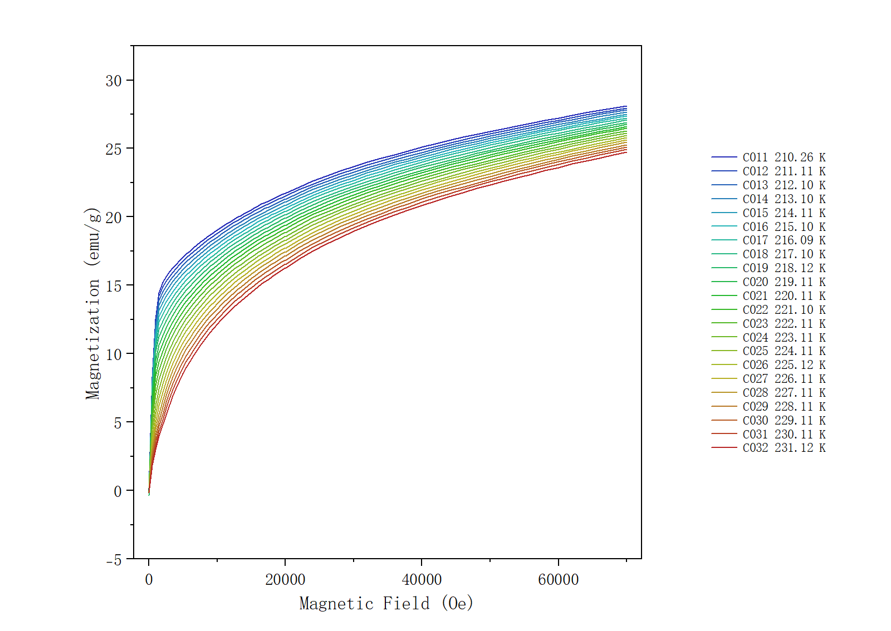
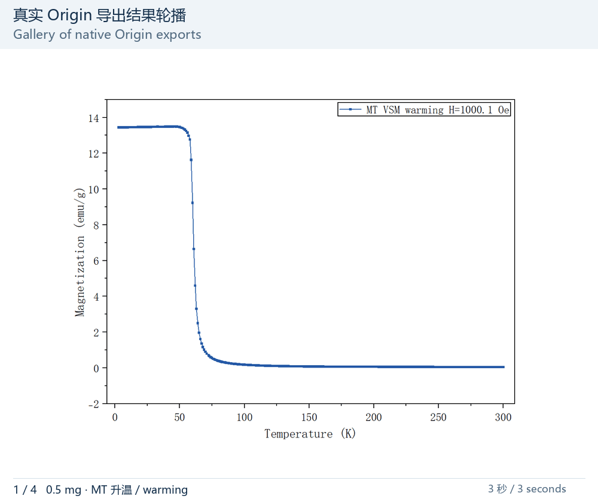
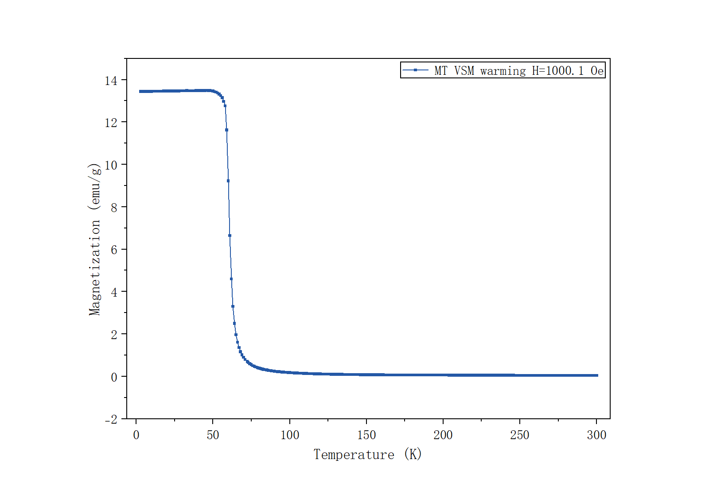
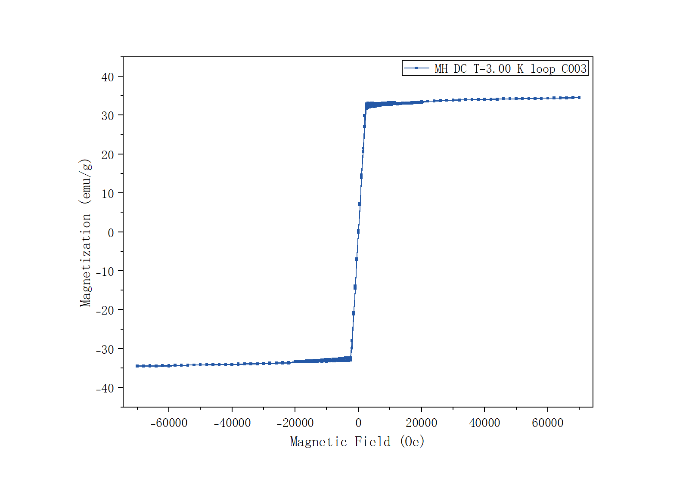
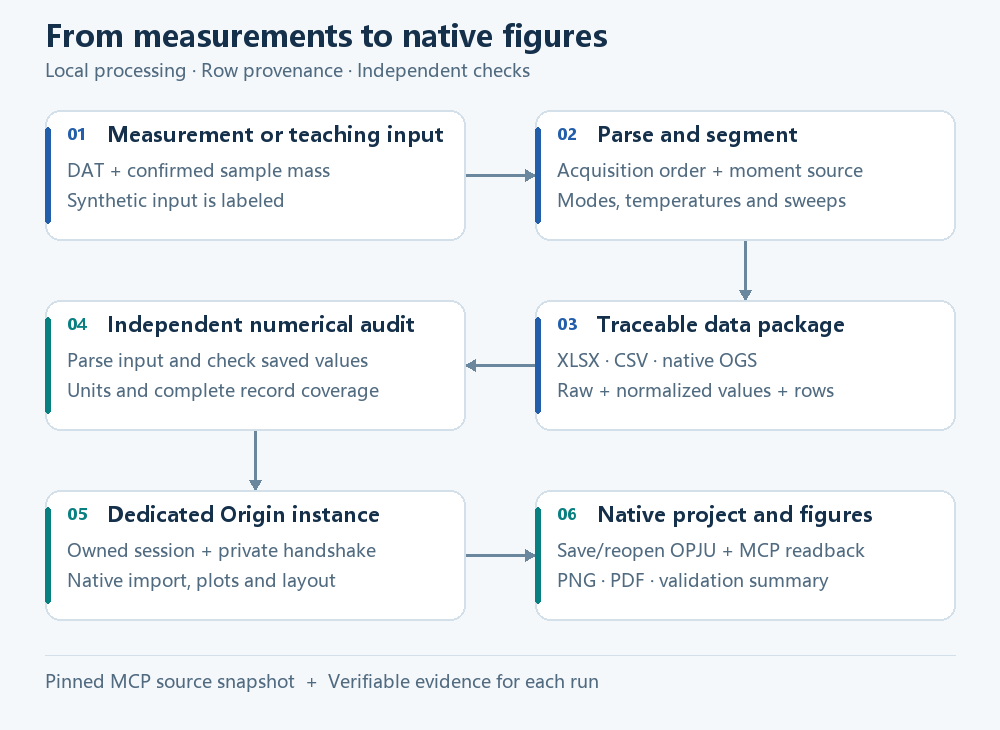

# Origin Magnetometry · Codex Skills

[中文](README.md) · [User guide](docs/en.md) · [Cases and validation](docs/validation.md) · [Provenance and licensing](docs/provenance.md)

Turn MPMS3 magnetometry DAT files into traceable Origin data and figures. Parse temperature, field and moment, preserve acquisition order, normalize by sample mass, export XLSX/CSV and LabTalk OGS, then use a dedicated Origin session to plot, save and reopen an OPJU, read values back, and export PNG/PDF.

Built for Codex users who need a reproducible experimental workflow. The repository includes a generated teaching example, two authorized real DAT files, results and validation entry points, and a pinned Origin MCP source snapshot.



*Real measurements exported by OriginPro 2026. Each curve retains the measured field values from its own acquisition segment.*

## From DAT to a verifiable project

- **Preserve every record:** segment continuous measurement modes, temperature plateaus and sweeps, retain source row mappings, and flag partial sweeps or incomplete loops.
- **One numerical result:** XLSX, CSV and Origin share the converted values; both raw moment and mass-normalized values remain available.
- **Native deliverables:** editable OPJU projects, individual curves, grouped overviews, and PNG/PDF exports.
- **Check the reproduction:** audit exported values against an independent parse of the input; reopen the saved project and read it through MCP, recording the runtime and upstream version.

## Quick start

The complete plotting workflow needs **Windows and an installed, usable Origin/OriginPro license**. The first hardware-tested baseline is Python 3.13.9 / OriginPro 2026 (10.30018); bootstrap checks that Python version. Data conversion alone does not require Origin.

Run from the repository root:

```powershell
pwsh -NoProfile -File scripts/bootstrap.ps1
.\.venv\Scripts\python.exe scripts/doctor.py
.\.venv\Scripts\python.exe scripts/reproduce.py --case all --output runs/demo
```

`bootstrap.ps1` creates a repository-local environment and installs pinned dependencies and the bundled MCP snapshot. Use a new output directory for each run. The adapter creates and checks the Origin instance owned by that run before changing a project.

To inspect tables and segmentation first, run the conversion stage:

```powershell
.\.venv\Scripts\python.exe scripts/reproduce.py --case synthetic --conversion-only --output runs/tutorial
```

For your own input, provide the actual sample mass:

```powershell
.\.venv\Scripts\python.exe scripts/reproduce.py --input "my-measurement.dat" --mass-mg 2.5 --output runs/my-sample
```

Use `--raw` for raw emu output. See the [user guide](docs/en.md) for mass, moment columns, segments and experimental labels.

## Reproducible cases

| Case ID | Input | Mass | Records / segments | Purpose |
|---|---|---:|---:|---|
| `synthetic` | Regenerable synthetic DAT | 2 mg | 41 / 3 | Learn the columns, segmentation and normalization |
| `real-0p5mg` | Authorized MPMS3 DAT | 0.5 mg | 1,809 / 27 | MT, loops and multitemperature one-way sweeps |
| `real-24mg` | Authorized MPMS3 DAT | 24 mg | 4,242 / 32 | VSM/DC, multiple temperatures and a partial sweep |



*Gallery of native Origin exports: browse four actual hardware-run outputs, displayed for three seconds each. Rebuild it with the [rendering script](assets/render_gallery.py); the [source manifest](assets/gallery.sources.json) records original image hashes.*





On 2026-11-18, the current entry point completed all three cases end to end in a separate environment on the same machine. It produced **5, 30 and 37** graphs with PNG/PDF exports and passed OPJU reopening and numerical readback. See [cases and validation](docs/validation.md) for tolerances, evidence and untested environments.

## Data flow



[SVG original](assets/pipeline.en.svg) · [Maintainable Mermaid source](docs/architecture.md)

Python processes data locally; Origin creates native figures locally. The MCP source in `third_party/origin-mcp` is pinned to [`ddab4420ccc7d17c056285b3b75191b1b81e48e5`](https://github.com/Ge-Shun/origin-mcp/commit/ddab4420ccc7d17c056285b3b75191b1b81e48e5).

## Use in Codex

`plugin.json` and `.agents/plugins/marketplace.json` package the workflow as a skills plugin. After installation, invoke `$origin-mpms-import` so Codex can locate the complete repository and run the workflow. See the [guide](docs/en.md#use-in-codex) for setup and checks. Environment readiness and successful task execution are recorded separately.

## License and applicability

Repository code is [MIT](LICENSE). Authorized DAT files and the tables, projects and figures generated for this repository use [CC BY 4.0](DATA-LICENSE). The MCP snapshot retains its upstream license and NOTICE; see [provenance](docs/provenance.md). Users obtain their own Origin/OriginPro license.

Automatic segmentation organizes continuous acquisition records. Users supply experimental labels such as orientation and ZFC/FC. Cleaning, fitting and physical conclusions require the relevant experimental evidence. Validation for other Origin versions, machines and hosts is listed in [the validation record](docs/validation.md).
