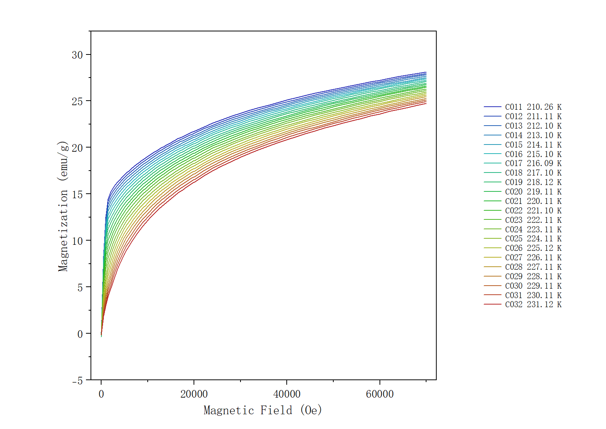
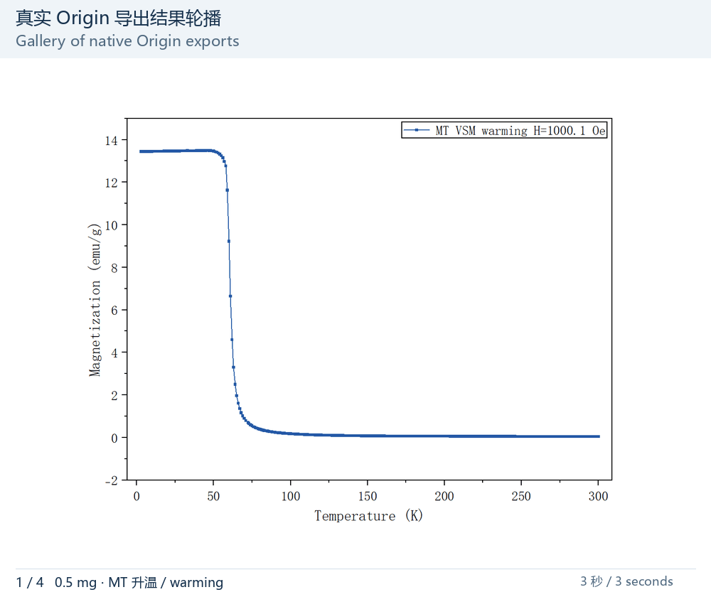
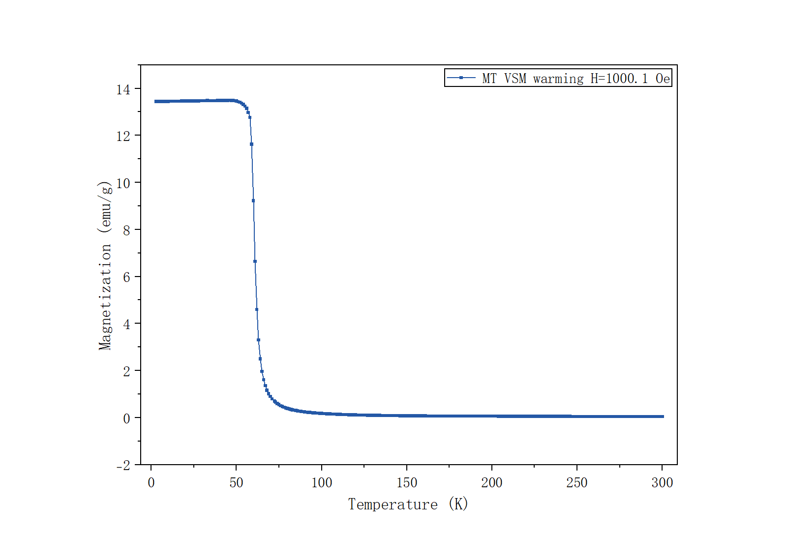
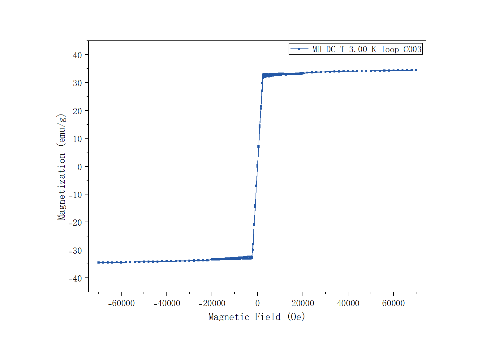
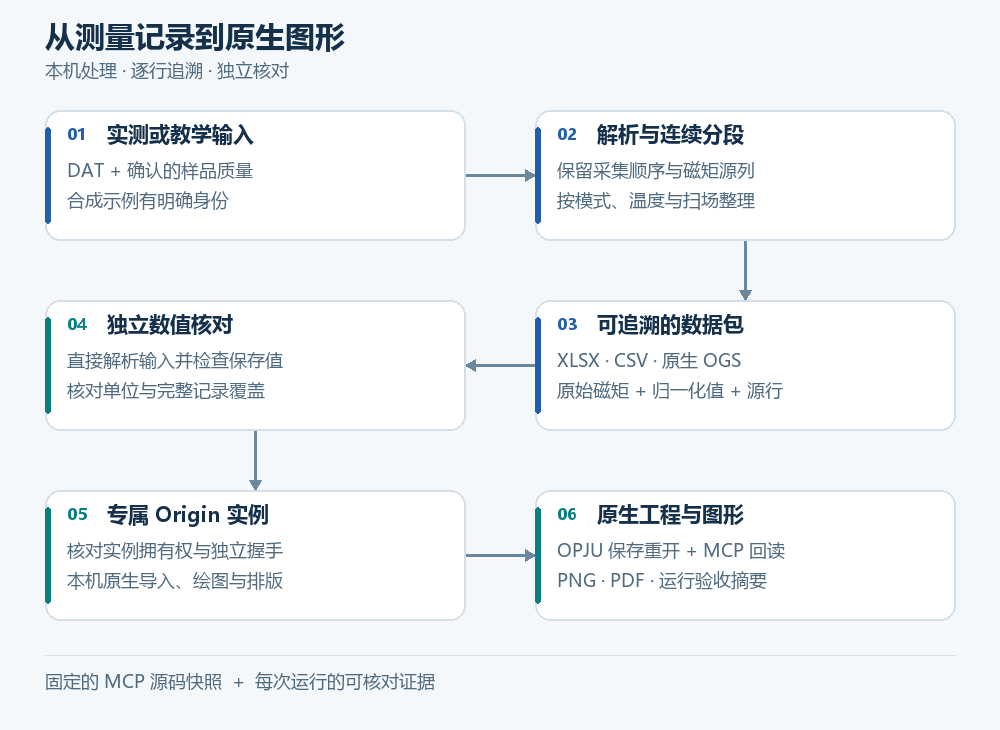

# Origin Magnetometry · Codex Skills

[English](README.en.md) · [使用指南](docs/zh-CN.md) · [案例与验收](docs/validation.md) · [来源与许可](docs/provenance.md)

把 MPMS3 磁测 DAT 整理成可追溯的 Origin 数据与图形：解析温度、磁场和磁矩，保留采集顺序，按样品质量换算，生成 XLSX、CSV 和 LabTalk OGS，再通过专属 Origin 会话完成绘图、OPJU 保存重开、数值回读及 PNG/PDF 导出。

面向需要复现实验数据处理的 Codex 用户。仓库包含合成教学示例、两份授权公开的真实 DAT、结果与验收入口，以及固定提交的 Origin MCP 源码。



*真实数据经 OriginPro 2026 导出的多温度图。每条曲线保留所属测量段的实际磁场列。*

## 从一份 DAT 到可核对的工程

- **完整保留记录**：按连续模式、温度平台与扫场分段，输出源记录行号对应表，保留部分扫场和未闭合回线的提示。
- **统一数值来源**：XLSX、CSV 和 Origin 使用同一转换结果；原始磁矩与质量归一化值同时保留。
- **完整原生交付**：生成可编辑的 OPJU、逐段图、分类总览，以及 PNG/PDF。
- **可核对的复现**：独立解析输入核对导出值，工程保存重开后通过 MCP 回读，并记录实际环境和上游版本。

## 快速开始

完整绘图需要 **Windows、已安装且可用的 Origin/OriginPro**。首版实机基线为 Python 3.13.9 / OriginPro 2026（10.30018）；引导脚本检查该 Python 版本。仅转换数据时不需要 Origin。

在仓库根目录执行：

```powershell
pwsh -NoProfile -File scripts/bootstrap.ps1
.\.venv\Scripts\python.exe scripts/doctor.py
.\.venv\Scripts\python.exe scripts/reproduce.py --case all --output runs/demo
```

`bootstrap.ps1` 创建仓库独立环境并安装固定依赖及随仓库分发的 MCP 快照。每次复跑使用新的输出目录。专属适配层创建并核对本次 Origin 实例，再执行工程操作。

先了解表格与分组结果，可运行转换阶段：

```powershell
.\.venv\Scripts\python.exe scripts/reproduce.py --case synthetic --conversion-only --output runs/tutorial
```

处理自己的文件时，明确实际样品质量：

```powershell
.\.venv\Scripts\python.exe scripts/reproduce.py --input "my-measurement.dat" --mass-mg 2.5 --output runs/my-sample
```

选择原始 emu 输出时使用 `--raw`。质量、磁矩源列、测量段和实验标签的解释见[使用指南](docs/zh-CN.md)。

## 实践案例

| 案例 ID | 输入 | 质量 | 记录 / 测量段 | 复现用途 |
|---|---|---:|---:|---|
| `synthetic` | 可重新生成的合成 DAT | 2 mg | 41 / 3 | 阅读列结构、分段与换算 |
| `real-0p5mg` | 授权公开的 MPMS3 DAT | 0.5 mg | 1,809 / 27 | MT、回线及多温度单向扫场 |
| `real-24mg` | 授权公开的 MPMS3 DAT | 24 mg | 4,242 / 32 | VSM/DC、多温度与部分扫场 |



*真实 Origin 导出结果轮播：四幅实机输出按图形浏览展示，每图停留 3 秒。可用[生成脚本](assets/render_gallery.py)重新制作；[来源清单](assets/gallery.sources.json)记录原图摘要。*





2026-11-18，当前统一入口在同机独立环境完成三例端到端复跑，分别生成 **5、30、37** 张图及对应 PNG/PDF，OPJU 保存重开和数值回读通过。复跑状态、数值容差及其他环境的未测范围见[案例与验收](docs/validation.md)。

## 数据流



[SVG 原图](assets/pipeline.zh.svg) · [可维护 Mermaid 源码](docs/architecture.md)

数据处理在本机 Python 执行，原生绘图在本机 Origin 执行。上游 MCP 源码保存在 `third_party/origin-mcp`，固定为 [`ddab4420ccc7d17c056285b3b75191b1b81e48e5`](https://github.com/Ge-Shun/origin-mcp/commit/ddab4420ccc7d17c056285b3b75191b1b81e48e5)。

## 在 Codex 中使用

仓库以 `plugin.json` 和 `.agents/plugins/marketplace.json` 提供纯技能包装。安装后调用 `$origin-mpms-import`，让 Codex 从技能入口定位完整仓库并执行复跑。安装与环境检查见[指南](docs/zh-CN.md#在-codex-中使用)。本地环境就绪与真实任务通过分别记录。

## 许可与适用范围

本仓库代码采用 [MIT](LICENSE)；授权公开的 DAT 及本仓库生成的表格、工程与图像采用 [CC BY 4.0](DATA-LICENSE)。第三方 MCP 保留原作者许可与 NOTICE，来源见[溯源说明](docs/provenance.md)。Origin/OriginPro 由使用者自行取得许可。

自动分段用于整理连续采集记录。实验方向、ZFC/FC 等标签由使用者提供；清洗、拟合和物性结论需要相应实验依据。其他 Origin 版本、其他设备与宿主的验收状态见[验证记录](docs/validation.md)。
