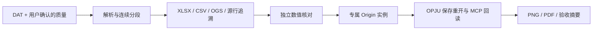
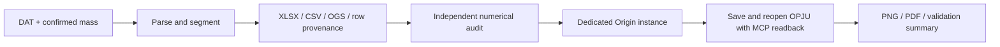

# 数据流与图源 / Data flow and diagram source

[中文 SVG](../assets/pipeline.zh.svg) · [English SVG](../assets/pipeline.en.svg)

The diagrams show capability relationships. They do not represent a UI screenshot or a recorded execution. / 本图说明能力与数据关系。

## 中文

## English

`assets/render_architecture.py` maintains the bilingual SVG and PNG files. Run it with Pillow on Windows; its text is ordinary editable source. The diagrams use repository-authored content under MIT. / 图解由可编辑脚本维护，采用 MIT；Windows 上使用 Pillow 重生成。

The individual Origin plots linked from the README are scientific outputs under CC BY 4.0, as recorded in [provenance](provenance.md). / README 的科学图形另按 CC BY 4.0 署名。
